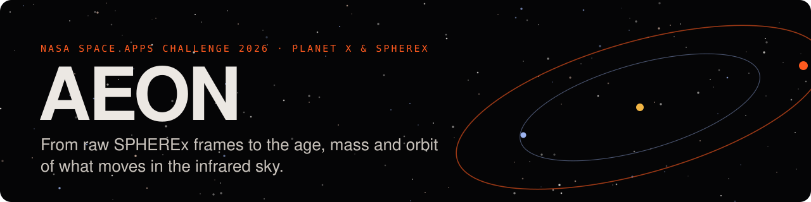
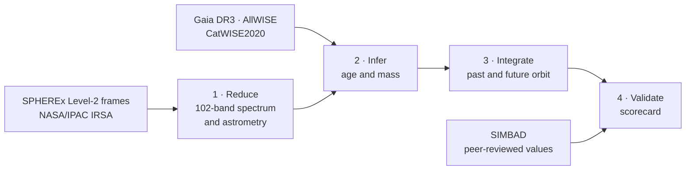
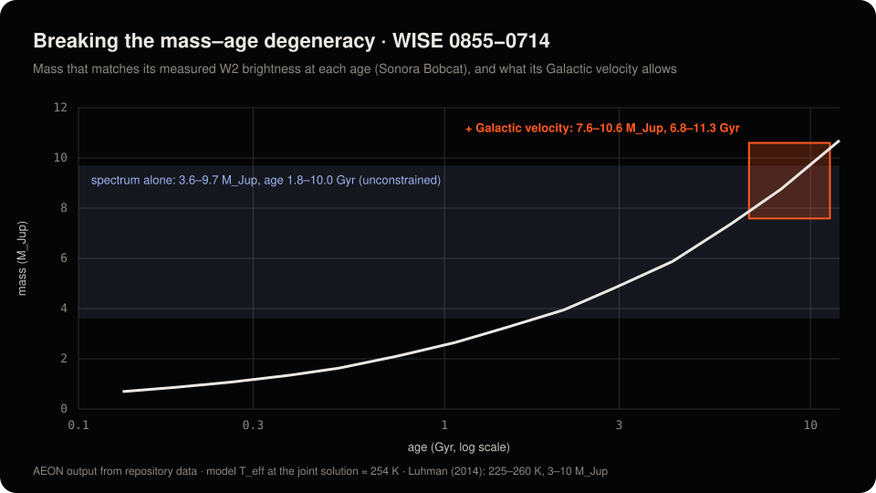
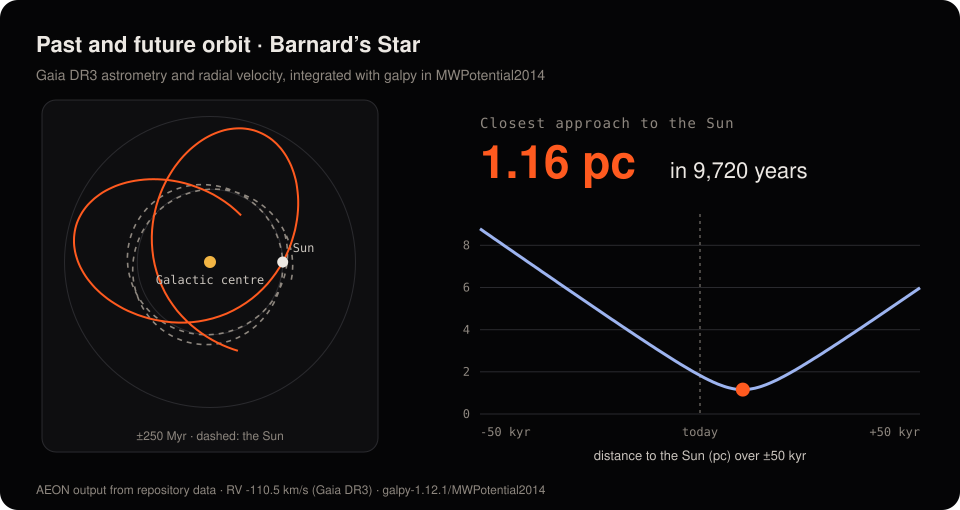
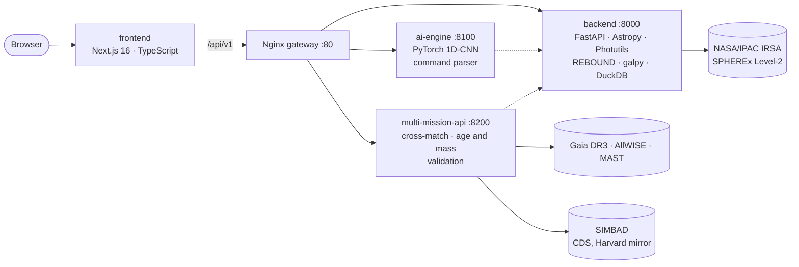

<p align="center">
  
</p>

<p align="center">
  <a href="https://github.com/alpztel/aeon/actions/workflows/ci-guard.yml"></a>
  <a href="LICENSE"></a>
  
  
  <a href="openapi.json"></a>
  
</p>

<p align="center">
  <b>NASA Space Apps Challenge 2026 · “Planet X and SPHEREx”</b> · Team AEON<br>
  <a href="#quick-start">Quick start</a> ·
  <a href="#how-it-works">How it works</a> ·
  <a href="#results">Results</a> ·
  <a href="#api">API</a> ·
  <a href="#acknowledgements">Acknowledgements</a> ·
  <a href="#türkçe-özet">Türkçe</a>
</p>

---

AEON is an open-source pipeline and web observatory for NASA’s **SPHEREx** all-sky survey. It starts from
real SPHEREx Level-2 spectral images (NASA/IPAC IRSA), extracts a clean **102-band near-infrared
spectrum (0.75–5.0 µm)** for a target, and then answers the questions a spectrum alone cannot:

- **How old and how massive is it?** A cooling brown dwarf of a given brightness can be light and young
  or heavy and old. AEON combines the spectrum with the object’s Galactic velocity to narrow that range.
- **Where was it, and where will it be?** Stars and brown dwarfs orbit the Galactic centre, so AEON
  integrates their orbits in the Milky Way (galpy) and finds their closest approach to the Sun.
  Solar-system candidates follow the Sun instead (REBOUND).
- **Does an independent reference agree?** Every result is set next to SIMBAD astrometry and
  peer-reviewed values in a validation scorecard.

> [!NOTE]
> **Project status: complete.** AEON was built for NASA Space Apps 2026. The hosted demo
> (`a-eon.engineer`) ran during the hackathon and has since been retired. The whole stack runs locally
> with Docker Compose; see [Quick start](#quick-start).

## At a glance

| | |
|---|---|
| **Data** | Real SPHEREx Level-2 spectral images; Gaia DR3, AllWISE and CatWISE2020 astrometry and photometry; SIMBAD |
| **Science chain** | 4 stages: reduce → infer age and mass → integrate orbits → validate |
| **Models** | Sonora Bobcat (substellar) and BHAC15 (stellar) evolution tables, used unchanged |
| **Targets** | 14 catalog objects in 5 classes: cold brown dwarfs, young stars, main-sequence stars, high-redshift quasars and one injected synthetic Planet X test object |
| **Services** | 3 FastAPI services behind an Nginx gateway, a Next.js 16 frontend, and a frozen 11-path OpenAPI contract |
| **Quality** | 400+ automated tests; every pull request runs contract validation, all test suites and a frontend build |
| **Principle** | Every number has a source, or the response says `unmeasured` |

## How it works



| Stage | Question | Method | Code |
|---|---|---|---|
| **1 · Reduce** | Which light belongs to the target? | 18-bit `FLAGS` mask, per-pixel wavelength from `WCS-WAVE`, 3σ-clipped zodiacal annulus, forced aperture photometry, neighbour-blend detection from centroid offsets, automatic choice of the epoch with the best real data | [`backend/aeon/archive.py`](backend/aeon/archive.py), [`photometry.py`](backend/aeon/photometry.py), [`service.py`](backend/aeon/service.py) |
| **2 · Infer** | How old and how massive? | Spectral channel: absolute W2 against Sonora Bobcat, or luminosity and temperature against BHAC15, on a mass–age grid. Kinematic channel: Galactic velocity (U, V, W) against the age–velocity dispersion relation. Their product narrows the degeneracy | [`multi-mission-api/app/age_mass.py`](multi-mission-api/app/age_mass.py), [`kinematics.py`](multi-mission-api/app/kinematics.py) |
| **3 · Integrate** | Where was it, where will it be? | galpy in `MWPotential2014`: ±250 Myr orbit and the closest approach to the Sun within ±50 kyr. REBOUND IAS15 for solar-system candidates | [`backend/aeon/galactic.py`](backend/aeon/galactic.py), [`orbit.py`](backend/aeon/orbit.py) |
| **4 · Validate** | Does a reference agree? | SIMBAD astrometry pushed through the same kinematics and orbit, plus literature values with bibcodes. A fixed rule (do the intervals overlap?) gives the verdict | [`multi-mission-api/app/validation.py`](multi-mission-api/app/validation.py), [`simbad.py`](multi-mission-api/app/simbad.py) |

## Results

All figures and numbers below are produced by the repository’s own code from repository data. Regenerate
them with [`docs/figures/make_figures.py`](docs/figures/make_figures.py).

### Breaking the mass–age degeneracy: WISE 0855−0714

<p align="center"></p>

The coldest known brown dwarf (2.28 pc). Its W2 brightness alone allows **3.6–9.7 M<sub>Jup</sub>** at almost
any age. Its fast Galactic motion makes a young age unlikely, and the joint solution is
**7.6–10.6 M<sub>Jup</sub> at 6.8–11.3 Gyr**, with a model temperature of about 254 K. Luhman (2014) finds
225–260 K and 3–10 M<sub>Jup</sub>. No radial velocity has been measured for it, so the velocity is an
envelope over RV = −30, 0 and +30 km/s, never a guessed value.

### Past and future orbit: Barnard’s Star

<p align="center"></p>

With Gaia DR3 astrometry and radial velocity, Barnard’s Star comes to **1.16 pc from the Sun in about
9,720 years**.

### Validation scorecard

AEON’s values next to SIMBAD (astrometry and radial velocity run through the same kinematics and galpy
orbit) and Ribas et al. (2018) for temperature, mass and age:

| Barnard’s Star | AEON | Reference | Verdict |
|---|---|---|---|
| Effective temperature (K) | 3040–3230 | 3278 ± 51 | consistent |
| Age (Gyr) | 6.52–9.32 | 7–10 | consistent |
| Mass (M<sub>☉</sub>) | 0.128–0.182 | 0.163 ± 0.022 | consistent |
| U, V, W (km/s, LSR) | −130, 17.1, 25.7 | −130, 17.4, 25.8 | consistent |
| Galactic pericentre / apocentre (kpc) | 5.92 / 15.3 | 5.93 / 15.3 | consistent |
| Galactic eccentricity | 0.441 | 0.441 | consistent |
| Closest approach to the Sun | 1.16 pc at +9.72 kyr | 1.16 pc at +9.73 kyr | consistent |

| Target | Consistent | Partly consistent | Discrepant | Why |
|---|---|---|---|---|
| Barnard’s Star | 13 | 0 | 0 | — |
| LHS 1140 | 12 | 1 | 0 | its closest approach falls outside the ±50 kyr window; the two edge distances differ by more than the 0.02 pc tolerance |
| TRAPPIST-1 | 6 | 6 | 1 | Gaia DR3 has no radial velocity for it, so AEON uses an envelope; SIMBAD lists −52 km/s. The scorecard names this as the cause |

### Planet X search on a synthetic test object

PX-2026-09 does not exist on the sky. It is injected at 520 AU to test the detection chain end to end and
is flagged `is_synthetic: true` in every response and on every screen.

| Method | Stacked S/N | Outcome |
|---|---|---|
| Straight-line shift-and-stack | 2.3 | missed: the ~400″ annual parallax smears it |
| Parallax-tracked stack at 520 AU | **10.0** | recovered (single exposure S/N ≈ 2) |
| Blind search, ~1,700 hypotheses, ~4 s | **7.9** | finds 110″/yr, PA 60°, 519.7 AU |
| Orbit fitted to the stack’s own astrometry | — | 521 ± 1 AU, 110 ± 3″/yr, PA 62° |
| Same with SPHEREx-like cadence (two windows a year) | 9.2 | 524 ± 12 AU |

## The interface

The web observatory follows the same four steps. Each tool on the right-hand rail belongs to one:

| Step | Tools | What you see |
|---|---|---|
| **1 · Target and motion** | Example gallery (`G`), Motion detection (`D`), Shift and Stack (`S`) | Real targets grouped by class, a ± dipole between survey epochs, faint movers recovered below the single-frame noise |
| **2 · Spectrum and identity** | 102-band spectrum, Physical identity | Measured, interpolated and blended bands marked separately; molecular bands; class probabilities and physics diagnostics |
| **3 · Age and orbit** | Age and Orbit (`3`) | Spectral, kinematic and joint age; mass; the Galactic orbit and solar encounter, or a REBOUND orbit for solar-system candidates |
| **4 · Validation** | Validation scorecard | AEON next to SIMBAD and the literature, with the Gaia + SPHEREx + WISE SED |

Also: an epoch scrubber that marks which quarters hold real SPHEREx data, an English/Turkish interface,
a natural-language command palette (`Ctrl/⌘ K`), a guided tour and a one-click PDF report (`P`).

## Architecture



The gateway routes `/api/v1/ai/*` to the ai-engine, `missions`, `alerts` and `candidates` to the
multi-mission-api, and everything else to the backend. [`openapi.json`](openapi.json) is the single
contract all services and the frontend share.

## Quick start

**Requirements:** Docker with Compose, and Node.js 20 for the frontend. To run a service without
Docker, use Python 3.12.

```bash
git clone https://github.com/alpztel/aeon.git
cd aeon
docker compose -f deploy/docker-compose.yml --profile full up -d --build
curl http://localhost/api/v1/health
```

Then start the frontend against the gateway:

```bash
cd frontend
npm ci
echo "NEXT_PUBLIC_API_BASE=http://localhost" > .env.local
npm run dev
```

Open <http://localhost:3000>.

**Real SPHEREx data (optional).** Without archive files the services fall back to a physical sky model
and say so in every response (`data_mode: "physical_model"`). To serve real frames, download them into
the backend’s data volume and restart it:

```bash
docker compose -f deploy/docker-compose.yml exec backend python -m aeon.irsa fetch-demo
docker compose -f deploy/docker-compose.yml restart backend
```

`fetch-demo` downloads cutouts for WISE 0855, RW Aurigae and the PX-2026-09 field. A target with a few
hundred frames is about 1 GB to download and about 55 MB on disk. See [`backend/README.md`](backend/README.md)
for other targets and options.

**Optional settings** go in `deploy/.env`, which is never committed:

| Variable | Service | Effect |
|---|---|---|
| `ANTHROPIC_API_KEY` | ai-engine | Natural-language commands through Claude; without it a deterministic EN/TR rule-based parser answers |
| `MONGODB_URI` | multi-mission-api | Persistent candidate store; without it an in-memory store is used |
| `GCN_CLIENT_ID`, `GCN_CLIENT_SECRET` | multi-mission-api | Live NASA GCN notices; without them the endpoint returns an empty list rather than invented alerts |
| `AEON_FITS_SOURCE` | backend | Host folder with SPHEREx files to mount instead of the Docker volume |

Each service also runs on its own; see its README: [`backend`](backend/README.md),
[`ai-engine`](ai-engine/README.md), [`multi-mission-api`](multi-mission-api/README.md),
[`frontend`](frontend/README.md).

## API

| Path | Service | Purpose |
|---|---|---|
| `GET /api/v1/health` | backend | Version, engines and data mode |
| `GET /api/v1/catalog/search` | backend | Name or cone search; positions at the requested epoch |
| `GET /api/v1/sky/cutout` | backend | SPHEREx cutout as JSON or FITS |
| `GET /api/v1/spectrum` | backend | 102-band spectrum; picks the epoch with the best real data when none is given |
| `POST /api/v1/analysis/{method}` | backend | `difference`, `shift-stack` (parallax-aware digital tracking) or `blind-search` |
| `POST /api/v1/orbit/simulate` | backend | REBOUND orbit for solar-system bodies, galpy Galactic orbit and solar encounter for stars and brown dwarfs |
| `POST /api/v1/ai/command` | ai-engine | Natural language to UI actions |
| `POST /api/v1/ai/classify` | ai-engine | 1D-CNN class probabilities and physics diagnostics of a spectrum |
| `GET /api/v1/missions/crossmatch` | multi-mission-api | Gaia/WISE/MAST cross-match, SED, age and mass, Galactic orbit summary and validation scorecard |
| `GET /api/v1/alerts/gcn` | multi-mission-api | NASA GCN notices (API only) |
| `GET`, `POST /api/v1/candidates` | multi-mission-api | Candidate store (API only) |

The contract is frozen at 11 paths; new results are added as optional fields so older clients keep
working. CI rejects any change that breaks the schema or the path count.

## Testing

| Suite | Command | Tests |
|---|---|---|
| backend | `cd backend && pytest -q` | 228 |
| multi-mission-api | `cd multi-mission-api && pytest -q` | 75 |
| ai-engine | `cd ai-engine && pytest -q` | 120+ |
| Azure ingest | `cd backend && pytest -q ../deploy/azure` | 28 |
| frontend | `cd frontend && npm run lint && npm run typecheck && npm run build` | lint, types, build |
| gateway | `AEON_GATEWAY_URL=http://localhost pytest -q deploy/e2e` | all 11 paths end to end |

Every pull request to `main` runs [`ci-guard`](.github/workflows/ci-guard.yml): folder isolation for
agent branches, OpenAPI validation, all Python suites and the frontend build. [`e2e`](.github/workflows/e2e.yml)
brings the whole stack up in Docker and tests each path through the gateway, and
[`stress`](.github/workflows/stress.yml) load-tests it on demand. Backend responses are validated against
`openapi.json` in the tests themselves.

## Repository layout

```text
aeon/
├── backend/            core FastAPI service: SPHEREx FITS pipeline, analyses, REBOUND and galpy orbits, DuckDB catalog
├── ai-engine/          FastAPI: 1D-CNN spectral classifier, physics diagnostics, command parser, model card
├── multi-mission-api/  FastAPI: Gaia/WISE/MAST cross-match, age and mass solver, SIMBAD validation scorecard
├── frontend/           Next.js 16 web observatory (English and Turkish)
├── deploy/             Docker Compose, Nginx gateway, end-to-end tests, Azure ingest and update scripts
├── docs/               reproducible README figures and team workflow notes
├── docs-and-reports/   user guide, demo script, Vercel guide, report template
├── stress/             load test for the whole stack
├── openapi.json        the API contract (11 paths)
├── AGENTS.md           rules for human and AI contributors
└── PROJECT_SPEC.xml    original project specification
```

## Scientific integrity

- **Real data first, labelled when not.** Every response carries `data_mode` (`fits_archive` or
  `physical_model`); interpolated spectral bands are flagged and never enter a fit.
- **Synthetic objects say so.** PX-2026-09 is an injected test object and is marked as such everywhere.
- **Nothing is invented.** A missing radial velocity becomes an envelope (−30, 0, +30 km/s). When SIMBAD
  is unreachable AEON tries the Harvard mirror, then a stored snapshot, and otherwise reports
  `unavailable`. Values outside the evolution models give no age or mass, only the reason.
- **Published inputs, unchanged.** Model tables are the authors’ files; literature values were read from
  the papers and carry their bibcodes ([`validation_reference.json`](multi-mission-api/fixtures/validation_reference.json)).

## Known limitations

- The 1D-CNN was trained on simulated spectra. On real data it still mislabels WISE 0855, because the
  synthetic Y-dwarf templates have a deeper 3.3 µm methane trough than the real W1−W2 colour implies. The
  interface flags any disagreement between the network and the physics diagnostics.
- Bright stars saturate SPHEREx (Barnard’s Star, 18 Sco); AEON then uses the physical model and says so.
- SPHEREx pixels are 6.2″, so neighbours blend; blended bands are detected and kept out of every fit.
- Cold brown dwarfs have no measured radial velocity, so their orbits are envelopes rather than single
  solutions.

## Deployment

During the hackathon the frontend ran on Vercel and the API on an Azure virtual machine (Docker Compose,
Nginx and Let’s Encrypt), with a weekly job that pulled new SPHEREx and Gaia data into Azure Blob Storage.
The guides remain in the repository (Turkish): [`deploy/README.md`](deploy/README.md),
[`deploy/azure/README.md`](deploy/azure/README.md) and
[`docs-and-reports/deploy-vercel.md`](docs-and-reports/deploy-vercel.md).

## Acknowledgements

This publication makes use of data products from the Spectro-Photometer for the History of the Universe,
Epoch of Reionization and Ices Explorer (SPHEREx), which is a joint project of the Jet Propulsion Laboratory
and the California Institute of Technology, and is funded by the National Aeronautics and Space
Administration.

This research has made use of the SIMBAD database, operated at CDS, Strasbourg, France
(Wenger et al. 2000, A&AS, 143, 9).

AEON also uses data from the ESA Gaia mission (DR3), the Wide-field Infrared Survey Explorer (AllWISE and
CatWISE2020), the NASA/IPAC Infrared Science Archive, the Mikulski Archive for Space Telescopes and the
NOIRLab Astro Data Lab. Their acknowledgement policies:
[Gaia](https://www.cosmos.esa.int/web/gaia-users/credits) ·
[WISE](https://irsa.ipac.caltech.edu/Missions/wise.html) ·
[SPHEREx at IRSA](https://irsa.ipac.caltech.edu/Missions/spherex.html) ·
[MAST](https://archive.stsci.edu/publishing/mission-acknowledgements) ·
[Astro Data Lab](https://datalab.noirlab.edu/acknowledgments.php).

Models and methods: Sonora Bobcat evolution and photometry tables (Marley et al. 2021,
[doi:10.5281/zenodo.5063476](https://doi.org/10.5281/zenodo.5063476), CC BY 4.0); BHAC15 tracks
(Baraffe et al. 2015); solar motion (Schönrich, Binney & Dehnen 2010); age–velocity relation
(Aumer & Binney 2009); population kinematics (Bensby, Feltzing & Oey 2014); galpy (Bovy 2015);
REBOUND (Rein & Liu 2012) with IAS15 (Rein & Spiegel 2015); Astropy and Photutils.

Third-party software, data and fonts, with their licences, are listed in
[`THIRD_PARTY_NOTICES.md`](THIRD_PARTY_NOTICES.md).

## Citation

If AEON helps your work, please cite it. GitHub’s **Cite this repository** button reads
[`CITATION.cff`](CITATION.cff); in BibTeX:

```bibtex
@software{aeon_2026,
  author  = {{Team AEON}},
  title   = {{AEON}: from raw {SPHEREx} frames to the age, mass and orbit of what moves in the infrared sky},
  year    = {2026},
  version = {1.0.0},
  url     = {https://github.com/alpztel/aeon},
  license = {MIT}
}
```

## Team

**Team AEON**, İstanbul Medeniyet University, Physics Engineering: Alperen ([@alpztel](https://github.com/alpztel), lead),
Mucteba Özdemir, Ece, Filiz and Asya.

Contributions are welcome; see [`CONTRIBUTING.md`](CONTRIBUTING.md), the
[Code of Conduct](CODE_OF_CONDUCT.md) and the [security policy](SECURITY.md).

## License

AEON is released under the [MIT License](LICENSE). Third-party components keep their own licences; see
[`THIRD_PARTY_NOTICES.md`](THIRD_PARTY_NOTICES.md).

---

## Türkçe özet

AEON, NASA’nın **SPHEREx** tüm gökyüzü taraması için geliştirilmiş açık kaynaklı bir veri hattı ve web
gözlemevidir. IRSA’dan alınan gerçek SPHEREx Level-2 görüntülerinden hedefin temiz **102 bantlık
yakın-kızılötesi tayfını (0,75–5,0 µm)** çıkarır; ardından tek başına bir tayfın yanıtlayamadığı soruları
yanıtlar:

1. **İndirgeme:** `FLAGS` maskesi, piksel başına dalga boyu, zodyak arka planı, zorlanmış fotometri ve
   komşu kaynak karışımı tespiti.
2. **Yaş ve kütle:** Sonora Bobcat ve BHAC15 evrim modelleri ile Galaktik hızdan gelen kinematik yaşın
   birleşimi, kütle–yaş dejenereliğini daraltır.
3. **Yörünge:** Yıldızlar ve kahverengi cüceler için galpy ile Samanyolu’nda ±250 milyon yıllık yörünge ve
   Güneş’e en yakın geçiş; Güneş Sistemi adayları için REBOUND.
4. **Doğrulama:** Her sonuç SIMBAD astrometrisi ve hakemli literatürle aynı tabloda karşılaştırılır.

Örnek sonuçlar: WISE 0855’in kütlesi yalnız tayfla 3,6–9,7 M<sub>Jup</sub>, Galaktik hızla birlikte
7,6–10,6 M<sub>Jup</sub>; Barnard Yıldızı yaklaşık 9.720 yıl sonra Güneş’e 1,16 pc yaklaşacak ve doğrulama
karnesindeki 13 büyüklüğün 13’ü referansla tutarlı. PX-2026-09 gerçek bir gök cismi değildir; algılama
hattını sınamak için eklenmiş sentetik bir test nesnesidir.

Barındırılan demo hackathon sonrasında kapatıldı; tüm sistem yukarıdaki
[Quick start](#quick-start) adımlarıyla Docker Compose üzerinde yerelde çalışır. Ayrıntılı Türkçe
kullanım kılavuzu: [`docs-and-reports/user-guide.md`](docs-and-reports/user-guide.md).
